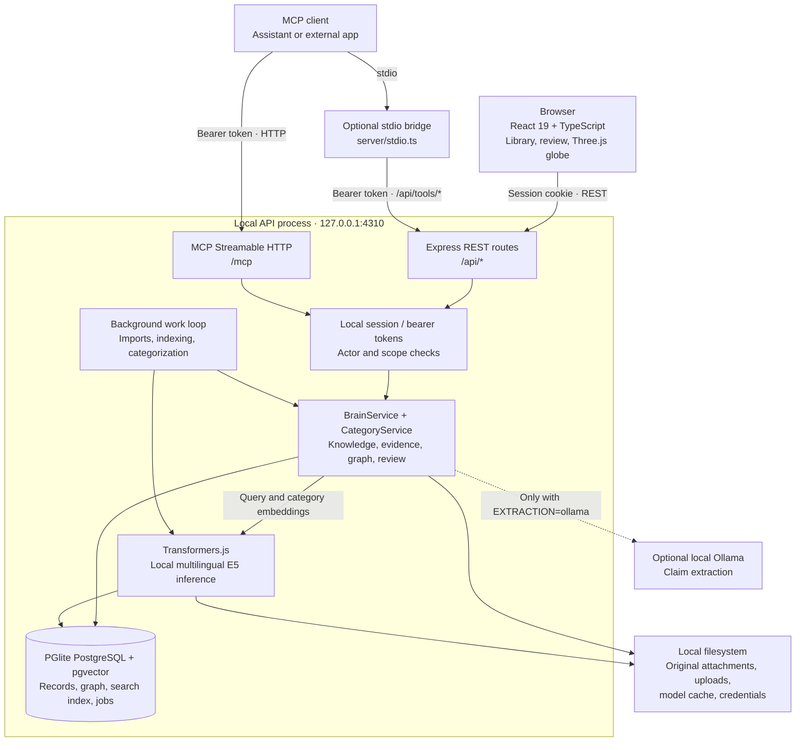
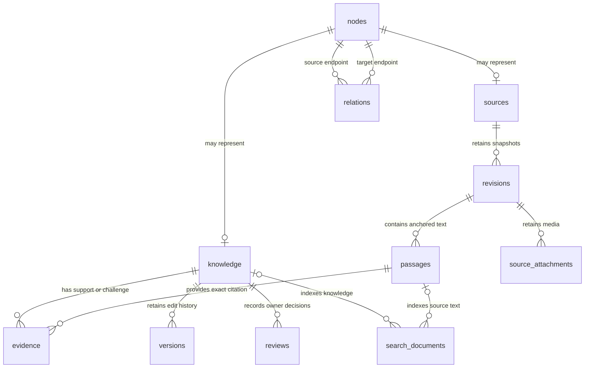
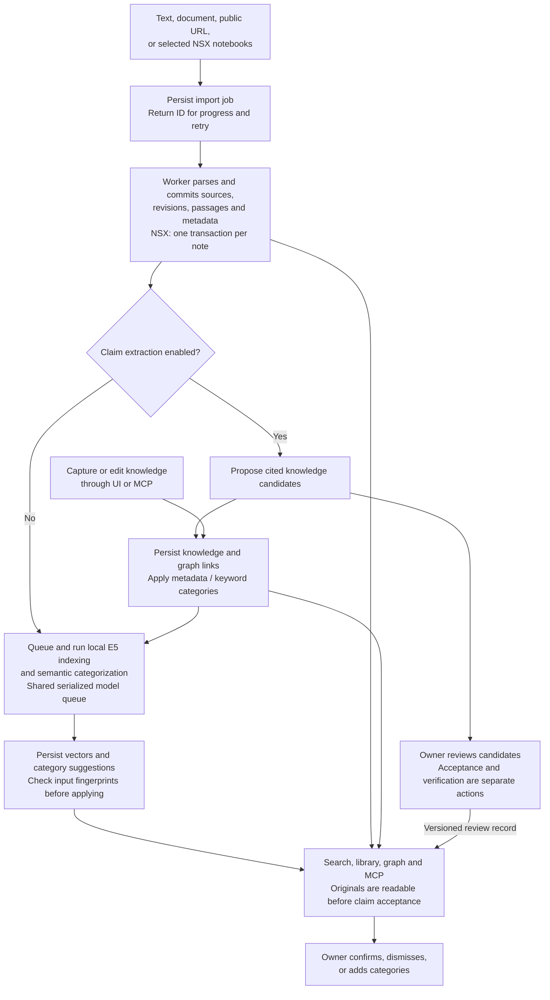

# Commonplace — Matt's Second Brain

A working personal knowledge spike: capture notes, import documents, inspect cited claims, review evidence, search by meaning, and explore the knowledge graph. A private web app and MCP share the same persistent application services.

## Run locally

Requires Node.js 22.12+ (tested with 22.17). No Python, Docker, database service, paid API key, or hosted model is needed.

```powershell
npm.cmd run setup
npm.cmd run dev
```

Open [the web app](http://127.0.0.1:5173). The API and MCP endpoint run at `http://127.0.0.1:4310`. On macOS/Linux, use `npm` instead of `npm.cmd`.

The setup script runs `npm ci` with the actual host OS/CPU. This matters on this machine because the global npm configuration targets Linux despite running Windows; the script overrides that setting for the install without changing global preferences.

The first launch adds clearly identified starter knowledge. The local embedding model downloads public weights to `.data/models`; source text is processed locally. The UI reports model loading/indexing, and keyword search remains available meanwhile. Windows may require a supported Microsoft Visual C++ runtime for native inference dependencies.

For one server serving the built app:

```powershell
npm.cmd run build
npm.cmd start
```

Open [the built app](http://127.0.0.1:4310). Stop with Ctrl+C. Only one API process may own a given data directory.

## What works

The web app uses an Apple-inspired interface with Liquid Glass navigation and globe controls, solid reading surfaces, and a library list beside an inline reader. Choose **System**, **Light**, or **Dark** in Settings → **Appearance**, or use the toolbar appearance button. Preferences are saved in this browser. **Reduce transparency** switches glass to solid surfaces; device preferences for reduced motion and reduced transparency are also respected. On mobile, selecting a library item opens the reader with a **Back to collection** action.

- Capture observations, preferences, hypotheses, inferences, and factual claims with topics, project context, optional structured triples, validity dates, and review intervals.
- Import pasted text, UTF-8 Markdown/text, HTML, text PDFs, and public web pages. Retain originals, exact passage anchors, hashes, and source revisions.
- Import Synology Note Station NSX archives with notebook selection, original dates/tags, native note JSON, downloadable attachments, and optional claim extraction.
- Durable import jobs with restart recovery, explicit failures, retry, duplicate protection, and a 40-candidate extraction cap.
- Review candidates individually or in batches. Acceptance and substantive verification remain separate. Evidence support/challenge, independent source lineages, stale verification, conflicts, and supersession are visible.
- Search PostgreSQL full-text and real pgvector embeddings, fuse ranks, and optionally expand explicit graph connections. English and German paraphrase checks use the actual local model.
- Ask for a cited evidence digest; insufficient relevant knowledge is reported as a gap.
- Animated Three.js knowledge globe with glowing nodes, flowing connection arcs, drag/zoom, smooth node flights, motion controls, topic filters, and an accessible list view. Merge duplicate named entities and undo merges.
- Versioned edits and review history, archival/restoration, item/source deletion, portable export, and empty-workspace restore with search-index rebuilding.
- Fourteen typed MCP tools over stateless Streamable HTTP, plus a stdio bridge. Read-only and contribution tokens are separate; assistants cannot review/verify or physically delete data.
- Responsive web app with capture, library, sources, graph, review, and integration settings.

## Import from Synology Note Station

Open Sources → Import source → Upload file and choose your `.nsx` export. Click **Preview archive**, select notebooks, then **Import selected notebooks**. Each note becomes a separately searchable retained source; its notebook supplies project context unless you provide a project override. Original tags, notebook/stack names, and creation/modification timestamps remain visible. Imported dates do not imply factual verification.

Claim extraction is optional and off by default. Enable it to propose cited candidates for owner review, or re-import the same archive later with extraction enabled. Identical notes reuse existing revisions; changed note records create new revisions and invalidate earlier verification. Repeated extraction does not duplicate existing derived claims.

The knowledge library's default **All** view includes imported originals alongside accepted knowledge. **Imported notes** browses Note Station notes with paging and full-text search. **Accepted** lists curated knowledge items. Original sources appear in the globe even when no claims have been accepted; use notebook/project filters or a source's **Show connections** action to explore a large collection. The overview's accepted-knowledge count remains separate from the source count.

Available attachments are stored locally, with image thumbnails and authenticated downloads in the source detail view. The exact original note JSON—including native HTML and other exported fields—can also be downloaded. The reader displays safe text; complex rich-text layouts are retained in the original JSON rather than reproduced exactly. Attachment contents are not automatically parsed or OCR'd. Missing files, encrypted content, and empty/malformed notes are explicitly reported.

The importer supports JSON-format NSX exports, archives up to 512 MB, 10,000 notes, 500,000 readable characters per note, and individual attachments up to 64 MB. It reads ZIP entries without extracting arbitrary paths or buffering the whole archive. Each note commits independently; interrupted batches can be retried. Completed bulk uploads are removed after individual note records and media are retained. Personal `.nsx` exports and `.data/` are ignored by Git.

Settings → **Export backup** downloads a portable ZIP containing the database records and attachments. **Restore backup** accepts that ZIP or older JSON exports into an empty workspace. JSON API exports now use version 2 and embed small attachments; use the ZIP workflow for larger collections.

Read-only inspection and isolated migration checks are available:

```powershell
npm.cmd run nsx:inspect -- "C:\path\to\export.nsx"
npm.cmd run nsx:validate -- "C:\path\to\export.nsx"
```

The validation command writes to a new ignored `.data/nsx-validation-*` directory and leaves the live workspace unchanged.

## Categories and rescanning

The graph includes real category nodes: notes/sources/claims → **categorized as** → a narrower category → **category parent** → a broader category. New captures, imports (including NSX originals), and edits retain organizational metadata immediately and queue semantic categorization. The same local multilingual E5 model used for search compares note content, title, tags, and notebook/stack context with bilingual category descriptions. The initial catalog has 24 subject branches and includes up to 100 user-defined category leaves. Hierarchical tags such as `Personal / Learning` supply explicit branches. Note Station stack → notebook organization remains a separate Notebooks tree. Categories organize content; they do not accept claims or verify facts.

Open **Knowledge graph** to browse category parents and children with descendant counts. Selecting a branch filters to its descendants. The globe groups items near category hubs and keeps parents in bounded samples. **Organize categories**, available from notes, source details, and globe selections, shows assigned categories and other suggestions with confidence, similarity, and separation from alternatives. Confirm a suggestion, dismiss a category, add a custom path, or undo a correction. Confirmations and dismissals are stored independently from generated assignments and survive edits, rescans, and backups; ordinary assistants cannot override them.

Up to three semantic suggestions are retained. Strong enough matches appear as **Suggested** graph memberships; ambiguous matches stay available for review while the item remains **Uncategorized**. Confidence is a similarity/margin heuristic, not a calibrated probability. The minimum suggestion score defaults to 0.78; automatic membership requires at least 0.82 plus separation of 0.008 from the runner-up (or a very strong score of 0.88). Secondary automatic suggestions require 0.86. These thresholds passed a small bilingual fixture check, not a representative corpus accuracy benchmark. E5 classification inputs use the `query:` prefix. [E5 model card](https://huggingface.co/intfloat/multilingual-e5-small).

Long notes use at most eight distributed windows, retaining title/tags/folder context in each window; this samples rather than exhaustively classifies the entire note. Keyword categories are a provisional fallback while inference is pending or when `EMBEDDINGS=lexical`. Disabled/loading/failed models, pending work, and per-item errors are visible. Inference runs outside database transactions, rejects results after concurrent edits, and serializes access to the local model with search indexing.

Existing profiles get a background backfill on first startup with this categorization version. **Rescan categories** reruns semantic analysis across the existing corpus, with persistent progress, retry in Sources, and restart recovery. It preserves source originals, tags, evidence, knowledge versions, review state, and manual category decisions. Repeated scans do not duplicate nodes or links. Restoring an older backup also rebuilds categories. MCP clients can call `list_categories`, `get_item_categories`, `query_graph` with `category_id`, and `rescan_categories`, then monitor the returned job with `get_import_job`. `correct_item_category` requires owner review authority and an expected category-decision version. All processing stays local.

## Configuration

Copy `.env.example` to `.env` if you want to change defaults. Credentials and knowledge in `.data/` are ignored by Git.

| Setting                    | Default                        | Purpose                                                                                    |
| -------------------------- | ------------------------------ | ------------------------------------------------------------------------------------------ |
| `PORT`                     | `4310`                         | Local API / built web app port; Vite's development proxy expects this default              |
| `DATA_DIR`                 | `.data`                        | Persistent PostgreSQL data, attachments, temporary uploads, credentials, and cached models |
| `SEED_DEMO`                | `true`                         | Add starter notes only to an empty, unseeded workspace                                     |
| `EMBEDDINGS`               | `local`                        | Local transformer inference; use `lexical` to disable semantic inference                   |
| `EMBEDDING_MODEL`          | `Xenova/multilingual-e5-small` | 384-dimensional ONNX model; other models must have 384 dimensions                          |
| `SEMANTIC_MIN_SCORE`       | `0.8`                          | Similarity cutoff, calibrated only on small spike fixtures; this is not a truth score      |
| `CATEGORY_MIN_SIMILARITY`  | `0.78`                         | Minimum semantic category suggestion score                                                 |
| `CATEGORY_AUTO_SIMILARITY` | `0.82`                         | Minimum automatic category score; separation/secondary-match guards also apply             |
| `EXTRACTION`               | `extractive`                   | Exact sentence candidates by default; `ollama` uses a local schema-constrained LLM         |
| `OLLAMA_URL`               | `http://127.0.0.1:11434`       | Loopback-only local model endpoint                                                         |
| `OLLAMA_MODEL`             | `qwen2.5:7b`                   | Optional extraction model installed separately in Ollama                                   |

To start an empty collection, set `SEED_DEMO=false` and choose a new `DATA_DIR` before starting. Changing embedding model namespaces queues re-indexing. A model download can be prepared independently with `npm.cmd run models:download`.

## MCP access

Open **Connections & settings** in the web app. Copy the local endpoint and choose either a read-only token or a read/contribute token. Tokens stay on disk and are not printed to the server log. The UI provides an example client configuration; individual clients use different configuration formats.

Available tools: `search_knowledge`, `get_knowledge`, `query_graph`, `list_categories`, `get_item_categories`, `correct_item_category`, `rescan_categories`, `add_knowledge`, `import_source`, `get_import_job`, `attach_evidence`, `review_knowledge`, `update_knowledge`, `archive_knowledge`. Review and category-correction tools require owner authority; ordinary MCP credentials cannot invoke them successfully.

For stdio, start the API first, then run `npm.cmd run mcp`. The bridge uses the same API/database, rather than opening a second database writer. A generic client configuration is:

```json
{
  "mcpServers": {
    "commonplace": {
      "command": "node",
      "args": [
        "C:/src/matts-second-brain/node_modules/tsx/dist/cli.mjs",
        "C:/src/matts-second-brain/server/stdio.ts"
      ],
      "env": {
        "DATA_DIR": "C:/src/matts-second-brain/.data",
        "BRAIN_API_URL": "http://127.0.0.1:4310"
      }
    }
  }
}
```

Adjust absolute paths for another checkout. Alternatively provide `BRAIN_MCP_TOKEN` explicitly to use a chosen token. Never commit actual tokens to client configuration examples or source control.

## Verify

```powershell
npm.cmd test
npm.cmd run test:semantic
npm.cmd run test:e2e
```

- Integration tests exercise PostgreSQL persistence, lifecycle rules, exact citations, PDF/HTML/NSX ingestion, notebook selection, interrupted migrations, source/attachment deletion, portable ZIP/JSON backup restore, and scope checks.
- Official SDK clients test tool discovery and actual read/write flows over HTTP and stdio.
- Semantic smoke tests use the real multilingual model and include an unrelated negative query.
- `npm run test:categories:semantic` checks actual English/German semantic category rankings and abstention on ambiguous text. Integration checks cover correction persistence, backup restore, inference races and model errors.
- Playwright builds the app and tests capture/edit/archive/forget, import/review/verify/citation, Note Station previews/notebook selection/attachment downloads/backups, graph/list/settings, and a mobile viewport. It uses installed Chrome on this Windows machine; on another host first run `npx playwright install chromium`.
- Browser screenshots are written to `.data/screenshots/`; traces from failures stay in `test-results/`.

## Architecture

Commonplace is a local TypeScript application with one API process owning an embedded PostgreSQL database. The browser and MCP clients use the same application services, authorization rules, and stored records. The graph is stored as explicit nodes and typed relationships; vectors provide semantic retrieval and category suggestions alongside that graph.

### Runtime and component boundaries



In development, Vite serves the browser app on port **5173** and proxies `/api` to the API. In a built installation, Express also serves `dist/`, so the UI and API share port **4310**. The stdio bridge forwards tool calls to the running API; it does not open another database connection or own another copy of the knowledge store.

| Responsibility          | Implementation                                                                                                                                                                       | Boundary                                                                                                                          |
| ----------------------- | ------------------------------------------------------------------------------------------------------------------------------------------------------------------------------------ | --------------------------------------------------------------------------------------------------------------------------------- |
| Browser workspace       | [`src/App.tsx`](src/App.tsx), [`src/LibraryReader.tsx`](src/LibraryReader.tsx), [`src/Appearance.tsx`](src/Appearance.tsx)                                                           | View navigation, inline reading, and browser-local appearance preferences; canonical knowledge remains on the server.             |
| Graph presentation      | [`src/Graph.tsx`](src/Graph.tsx), [`src/globe-layout.ts`](src/globe-layout.ts), [`src/globe-scene.ts`](src/globe-scene.ts)                                                           | Renders a bounded graph response. Category clusters are a visual layout, not geographic positions or a calibrated similarity map. |
| Transport and contracts | [`server/app.ts`](server/app.ts), [`server/mcp.ts`](server/mcp.ts), [`shared/contracts.ts`](shared/contracts.ts)                                                                     | REST and MCP adapters use shared Zod contracts and dispatch to application services.                                              |
| Knowledge and quality   | [`server/service.ts`](server/service.ts), [`server/quality.ts`](server/quality.ts)                                                                                                   | Versioned writes, exact citations, lifecycle and review rules, temporal freshness, graph queries, and hybrid retrieval.           |
| Organization            | [`server/category-service.ts`](server/category-service.ts), [`server/semantic-categories.ts`](server/semantic-categories.ts), [`server/categorization.ts`](server/categorization.ts) | Metadata and keyword fallback, queued semantic suggestions, rescans, and separately persisted owner corrections.                  |
| Ingestion and storage   | [`server/ingestion.ts`](server/ingestion.ts), [`server/nsx.ts`](server/nsx.ts), [`server/backup.ts`](server/backup.ts)                                                               | Parsing, bounded NSX processing, retained originals and attachments, portable backup and restore.                                 |
| Database and workers    | [`server/db.ts`](server/db.ts), [`server/schema.sql`](server/schema.sql), [`server/index.ts`](server/index.ts), [`server/embeddings.ts`](server/embeddings.ts)                       | Schema setup, durable job recovery, background processing, local model inference, and search-index rebuilding.                    |

### Data model: evidence, graph, and search

The following diagram shows the core persisted relationships. `knowledge`, `sources`, and named entities use IDs from `nodes`. Categories, topics, and projects are also graph nodes. The `relations` table links node IDs with types such as `categorized_as`, `category_parent`, `related_to`, and `contradicts`; there is no separate graph database.



Evidence links a knowledge item to an exact passage in a retained source revision. Passage anchors and offsets preserve citation context. Acceptance, verification, evidence support, and freshness are separate: importing a source or accepting a candidate does not verify it. Freshness is calculated from verification, applicability dates, and review intervals when knowledge is read; expiry changes its reported quality rather than automatically deleting it.

`search_documents` is a rebuildable index containing searchable text, a PostgreSQL full-text column, a 384-dimensional vector, the model namespace, and an input hash. Current-query retrieval combines lexical ranks and cosine-similarity ranks using reciprocal rank fusion, with optional expansion through explicit graph links. The server applies lifecycle, topic/project, and temporal filters; recorded-time searches use saved versions rather than current semantic vectors. Ask mode assembles a cited evidence digest from retrieved material.

Category suggestions and processing state live in `categorizations`. Owner accept/dismiss decisions live independently in `category_decisions`, so a rescan can replace generated suggestions while preserving manual corrections. Suggestion confidence describes classification strength, not whether the note is true.

### Import, indexing, and review flow



The API process runs a background loop every second for import jobs, pending search documents, and pending categorizations. Jobs and category progress survive restarts; import retries reuse committed records. NSX commits one note at a time so a failed batch can resume without duplicating completed notes. Inference runs outside database transactions and uses input hashes/fingerprints to avoid applying results to concurrently changed content. Keyword search and provisional metadata/keyword categories remain available while the local model loads, fails, or is disabled.

### Persistence and access

Under the configured `DATA_DIR`, `postgres/` holds the persistent PGlite database, `files/` holds disk-backed uploads and content-addressed attachments, `models/` caches downloaded model weights, and `credentials.json` holds local credentials. Appearance preferences stay in browser `localStorage`. Portable ZIP backups contain a database-record manifest and attachments; restore targets an empty workspace and rebuilds derived indexes. One API process must own a given data directory.

The browser obtains an HttpOnly, SameSite session cookie for the local owner. MCP uses separate read-only and read/contribute bearer tokens. Scope checks are enforced in application services as well as relevant routes: ordinary assistant tokens can propose knowledge but cannot verify claims, override owner category decisions, or physically delete data. Local Host/Origin guards restrict access to the loopback deployment; this is not a multi-user or remote authentication design.

## Spike limits

React/TypeScript/Vite + Three.js, an Express/TypeScript backend, filesystem-persistent PGlite PostgreSQL with pgvector, Transformers.js local E5 embeddings, and the official TypeScript MCP SDK. This implements the concept's knowledge architecture using the runtime available in the workspace. [PGlite persistence](https://pglite.dev/docs/), [pgvector extension](https://pglite.dev/extensions/), [MCP SDK](https://github.com/modelcontextprotocol/typescript-sdk).

The spike uses one local process with durable database jobs instead of Python/FastAPI, Celery/Redis, and a separate PostgreSQL service. This is a single-owner local application. It binds to loopback, rejects hostile Host/Origin headers, and protects MCP with scoped bearer tokens. It has no remote OAuth deployment, multi-user isolation, or high availability.

Default extraction proposes exact source sentences, and ask mode returns an evidence digest. Optional Ollama extraction validates schema and cited quotes but still needs human review; that optional provider is not part of the automated live-model verification. Scanned PDF OCR, complex-table fidelity, free-form answer generation, connector sync, automated revalidation, background backup management, and the PRD's large-corpus performance/quality gates remain follow-up work.

Restore imports a JSON archive into an empty workspace and replays tombstones present in the workspace/archive. Previously downloaded exports can still contain forgotten knowledge. Keep the newest deletion history with backups; the spike cannot retroactively erase independent export files. Import limits are 25 MB/file, 200 PDF pages, and 500,000 parsed characters; JSON restore requests are capped at 50 MB.

## Documentation

- [Concept and original technology proposal](docs/concept.md)
- [Draft PRD](docs/prd.md)
- [Spike implementation, validation, and next decisions](docs/spike.md)
