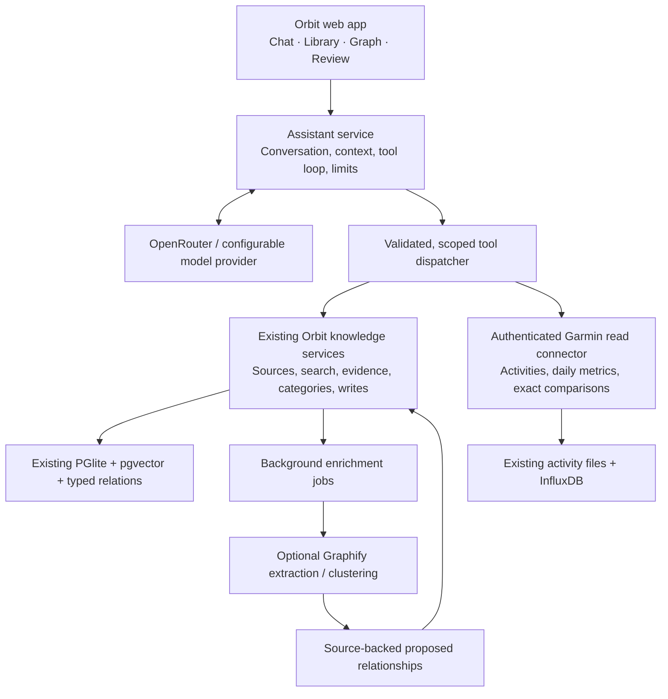

# Orbit assistant with Garmin and optional Graphify

Status: proposal accepted and implemented as an integrated spike, 25 October 2026. See [the implemented assistant and its current limits](assistant.md) and [NAS companion setup](synology-assistant.md). The findings below describe the assessment that informed the implementation; external API findings and primary references are in [the research note](assistant-integration-research.md).

## Product direction

Make Orbit the main place to ask questions, reason over personal knowledge, and explicitly save useful outcomes. Connect the existing Garmin application as a specialist data source. Keep its collectors, original activity files, InfluxDB, and Grafana working independently. Add Graphify as optional, rebuildable enrichment after the assistant and Garmin connection prove useful.

The desired journey is: ask a question → inspect cited notes and locally calculated data → ask follow-ups → save a useful conclusion, note, or source → see its provenance and proposed connections in Orbit.

## Findings from the existing projects

These findings come from local source inspection, not claims about a running NAS installation or model quality:

| Component                               | Current behavior                                                                                                                         | Reuse / extension                                                                                                                     |
| --------------------------------------- | ---------------------------------------------------------------------------------------------------------------------------------------- | ------------------------------------------------------------------------------------------------------------------------------------- |
| Orbit `server/service.ts`, `answer`     | Performs existing retrieval and returns an `evidence_digest` with excerpts and a templated summary.                                      | Keep the retrieval and citation services; add actual conversation and model orchestration.                                            |
| Orbit `server/mcp.ts`                   | Shares schemas, scope checks, versioned edits, imports, candidate creation, and owner-only review operations.                            | Use these same domain operations for the assistant; MCP remains the external-client adapter.                                          |
| Garmin `app/chat/providers.py`          | Supports built-in, OpenRouter and Ollama paths. Hosted mode plans one validated query and explains calculated facts in a second request. | Reuse the provider/privacy/accounting patterns. Orbit needs a multi-tool conversation loop rather than the fixed single-query schema. |
| Garmin `app/chat/data.py`, `DataTools`  | Filters/deduplicates activities and calculates totals/comparisons locally; queries health with an allowlisted read-only InfluxDB path.   | Expose typed read operations through a small authenticated connector. Keep numeric calculations here.                                 |
| Garmin `app/chat/data.py`, `GraphIndex` | Deterministically builds activity/sport/month relationships using Graphify and refreshes after its input changes.                        | Reuse activity-context navigation. This is not yet semantic reasoning across Orbit's notes and all Garmin metrics.                    |
| Garmin `app/chat/server.py`             | Saves conversations, supports follow-up query context, progress events and cloud-usage accounting.                                       | Reuse the interaction patterns and limits; implement the integrated UI in Orbit's React app.                                          |

The inspected project-root Graphify export contains 234 nodes and 412 edges. A local, bounded vocabulary-based query found activity/sport neighborhoods; it was truncated and does not establish complete coverage. The chat's runtime graph is generated separately under its state directory. These exports are not a code architecture index and do not imply that all health data has been graphed. No private metric values or credentials are included in this proposal, and no private content was submitted to hosted inference for the assessment.

## Architecture

One web entry point can coordinate several services. A database merge is unnecessary for the first version. Use a thin typed Garmin API or MCP adapter over its data tools; do not automate the human chat endpoint, expose arbitrary SQL, share Garmin login tokens with the model, or duplicate collectors in Orbit. The Garmin project is outside this workspace's writable roots; changes there would be a separate implementation step.

## Assistant interaction

- Add a first-class **Assistant** page with saved conversations and streaming answers. Keep Library and Graph as useful exploration views.
- Let a conversation use **Knowledge**, **Garmin**, or **Both**. Show which context is selected and when cloud inference is enabled.
- Support questions, follow-ups, drafting, comparisons, and explicit capture/import requests. Allow general model background knowledge when selected, while distinguishing it from claims backed by the owner's sources.
- Show progress such as searching notes, calculating a comparison, or drafting a note. Include citations, calculation coverage, charts when useful, and a collapsible tool activity view.
- Display proposed writes as readable action cards with content, source links, and the resulting record. Avoid repeated confirmation for read-only queries. Generated knowledge remains proposed until an explicit save/review decision.
- Keep chat history separate from knowledge. Useful answers become saved notes only through an explicit action; conversation storage alone must not become corroborating evidence.

Example requests:

- “What have I saved about knee training, and which notes are most relevant to my recent activity?”
- “Compare my training consistency across the last three complete months.”
- “Summarize these sources, show disagreements, and save a draft with citations.”
- “Add this idea to my knowledge and suggest where it belongs.”

## Tool and permission boundary

Suggested initial tools:

| Tool family            | Operations                                                                                              |
| ---------------------- | ------------------------------------------------------------------------------------------------------- |
| Knowledge reads        | Search, fetch complete source/knowledge, inspect categories, inspect a bounded graph neighborhood.      |
| Knowledge proposals    | Create a candidate note, queue a source import, draft a versioned edit or relationship.                 |
| Garmin reads           | Get activity summaries, get allowlisted health series, compare periods and expose source/sync coverage. |
| Explicit owner actions | Apply a reviewed edit, accept/reject a candidate, confirm a category.                                   |

The browser's owner session must **not** give the model unrestricted owner authority. Dispatch model calls through a dedicated assistant actor and an explicit tool allowlist. Existing `BrainService.capture` already creates candidates for a non-owner actor. Owner review actions remain a separate UI/application command; a model cannot invoke `review_knowledge` simply because the owner is logged in. Reuse expected versions, idempotency and audit events for applied writes.

Each run needs bounded model/tool rounds, deadlines, context/output budgets, cancellation, and cost accounting. Treat retrieved notes as source data; text inside a note cannot grant tool permissions. Configuration secrets stay server-side.

## Garmin data in Orbit

Use two complementary representations:

1. **Live structured queries:** exact time series, counts, sums, comparisons, and coverage remain in Garmin's data layer.
2. **Searchable retained summaries:** optionally sync compact activity/week/month descriptions with stable external IDs, timestamps, units, connector version and references to the underlying records. Upsert changed records and track deletions rather than appending duplicates.

Do not put every heart-rate sample into embeddings or the globe. Link meaningful activities, periods, goals, notes, and curated observations. Existing Grafana remains useful for detailed charts.

Metric results should expose the requested interval, timezone/bucket definition, dates with data, last sync, units, calculation method/version, duplicate handling and exact source references. The existing health path uses UTC daily buckets; cross-domain comparisons need an explicit shared alignment policy before joining them with Europe/Berlin activity dates. Missing data remains unknown rather than zero.

A Garmin record is a device/service observation, not automatically a verified factual assertion or medical conclusion. Immutable historical observations do not need arbitrary expiration. Freshness applies to sync state and summaries; changed source records should mark derived results stale or trigger recomputation. Save important calculated results with a retained snapshot or revision identifiers so later citations can reproduce what the assistant saw.

## Graphify's role

Orbit already has a persisted graph and local semantic search. Evaluate Graphify for concept/entity extraction across notes, cross-source proposed relationships, community structure, and scoped retrieval. Run expensive extraction in background jobs or a separate worker, outside interactive requests.

Import through a versioned adapter with source/revision IDs, extraction/model version, source location, extraction method and confidence label. Preserve manual corrections. An `INFERRED` edge is a proposal, not proof; an `EXTRACTED` edge's label alone does not establish factual truth. Keep enrichment removable/rebuildable, and never use an LLM-created summary as independent evidence for itself.

Benchmark Graphify against existing hybrid retrieval before adopting it broadly. Compare answer correctness, source coverage, citation validity, useful additional connections, latency and cost. Similarity scores or visually interesting communities alone are insufficient success criteria.

## Hosting and cloud context

Keep Orbit and the Garmin stack separate initially on the DS423+ with its known 6 GB RAM. Use the existing hosted-model option for interactive reasoning, retain local search and exact calculations, and schedule enrichment within resource budgets. This is a deployment recommendation, not a NAS memory/latency benchmark.

Follow the Garmin project's existing explicit cloud-choice pattern. Health context is opt-in and defaults to bounded calculated summaries; note excerpts also leave the NAS when included in a hosted request. Preserve strict routing controls and visible cost limits. Zero-retention routing does not make a hosted call local; see [the researched provider constraints](assistant-integration-research.md).

## Implementation order and acceptance

1. **Assistant + knowledge:** conversations, provider configuration, streamed tool use, existing search/source tools and clickable citations. A follow-up can retrieve additional evidence; unsupported claims and general model context remain distinguishable.
2. **Conversational capture:** candidate creation/import and reviewable versioned edits. Explicit saves produce visible records; retries create no duplicates; generated output cannot self-verify or overwrite manual corrections.
3. **Garmin connector:** authenticated read-only queries, charts, optional summary sync and questions combining notes with calculated metrics. Offline Garmin produces a clear partial answer rather than invented numbers.
4. **Graphify evaluation:** representative cross-note questions and a source-backed relationship review flow; enable wider enrichment only if it improves retrieval or useful connections.

Verification should use synthetic fixtures for exact arithmetic, date boundaries/timezones, duplicate records, missing days, stale sync, source revisions, invalid model tool arguments, prompt injection, denied scopes, cancellation, budget limits, idempotent saves and expired edit versions. No hosted evaluation should send private notes or health records without the owner's selected context/consent.
