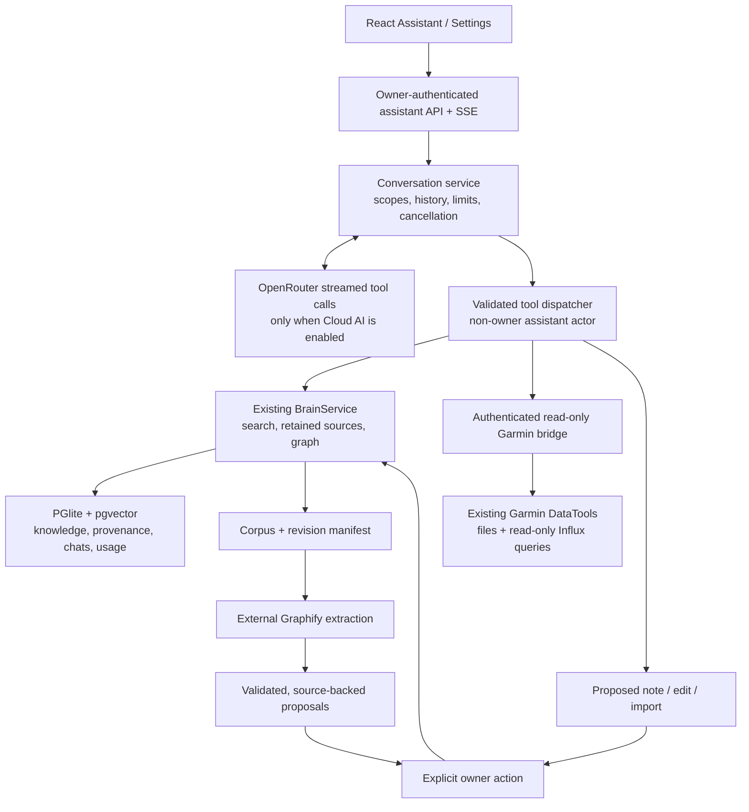

# Assistant, Garmin and Graphify

The Assistant page adds saved conversations, streamed OpenRouter answers, cited retrieval, Garmin charts and reviewable actions. The original library, graph, import and MCP services remain available. This is an integrated spike, not a benchmark of model accuracy or a replacement for the Garmin application.

## Try it locally

With Orbit running, open [the app](http://127.0.0.1:5173) and choose **Assistant**.

1. Ask about something in your collection with **Knowledge** selected. With **Cloud AI** off, Orbit returns a local evidence search; it does not call a model.
2. Open **Settings → Assistant & Garmin**, choose **OpenRouter AI**, set a model ID and API key, and save. Keys remain in the server's private data directory and are never returned by the settings API.
3. In Assistant, enable **Cloud AI** to ask questions and follow-ups. The model can search notes, read retained sources and inspect graph connections. Citation buttons open the retained excerpts or calculated Garmin snapshots.
4. Ask it to draft a note, edit a previously retrieved knowledge item, or import a public URL. Inspect the action card and choose **Save**, **Apply edit**, or **Queue import**. A proposal alone changes no knowledge. Saved generated notes are unverified derived inferences; imported claims still use the normal review flow.

Examples:

- “What do my notes say about learning? Cite the useful sources.”
- “Draft a short routine based on those notes, with the source references.”
- With Garmin connected: “Compare running hours in September 2026 and August 2026.”
- With **Both** selected: “Find my saved recovery notes and compare them with my recent training totals.”

**General knowledge** allows model background knowledge as well as retained evidence. Without it, answers are instructed to use retrieved evidence and report gaps. Citations identify what was retrieved; they do not prove that every generated sentence correctly follows from it. **Stop** cancels a running response. Conversations persist across reloads; deleting a conversation keeps its anonymous usage accounting and any separately saved knowledge.

## Connect the existing Garmin project

Start the existing Garmin Docker stack first. From the Orbit repository:

```powershell
npm.cmd run assistant:connect-garmin
# If your existing chat container has a different name:
npm.cmd run assistant:connect-garmin -- my-garmin-chat-container
```

The helper creates an Orbit-owned `orbit-garmin-bridge` container using the existing Garmin chat image. It mounts the existing chat volumes read-only, joins its data network, publishes only `127.0.0.1:4312`, and stores a random connector token under ignored `.data/`. It reuses an existing OpenRouter model/key server-side if Orbit has no key yet. It makes no model requests and does not modify the Garmin project, collectors or databases. Re-running it replaces only the bridge container with the expected Orbit ownership label.

Choose **Garmin** or **Both** in Assistant. With Cloud AI off, the bridge supports simple questions using Garmin's built-in query planner. Complex questions and follow-ups use the selected cloud model when enabled. Numeric queries and two-period differences are calculated locally, rather than delegated to the model.

Supported plans select activity totals or allowlisted health metrics, a sport, inclusive dates, and weekly/monthly grouping. Charts display at most 80 points; the retained result contains the full bounded series. Activity dates use Garmin's Europe/Berlin interpretation; daily health buckets are UTC. Missing observations remain unknown. Period totals are not normalized when periods have different lengths; health means cover only recorded days. A result includes sync status, source coverage, calculation version and capture timestamp.

The bridge deliberately reuses the installed Garmin `app.chat.data` interface. An incompatible Garmin image update may require an adapter update. It reads the existing `/state/auth.json` credential for the Garmin read-only database user; it has no credential-management or write endpoints. If Garmin is unavailable, Orbit reports that rather than substituting values.

There is no automatic bulk Garmin history synchronization in this spike. Keep raw activity files and health time series in Garmin. Save useful conclusions explicitly through assistant action cards; those knowledge items retain the cited calculated snapshots and appear in Orbit's search and graph.

## Optional Graphify enrichment

Settings → **Graphify connections** provides a local export/import/review workflow:

1. Export the corpus ZIP and unpack it. It contains UUID-named Markdown records and `orbit-manifest.json` with source revisions and hashes.
2. Run your existing Graphify tooling against the Markdown corpus. Keep the matching manifest. Graphify's extraction is an external step; Orbit does not silently run a hosted extractor.
3. Import Graphify's node-link `graph.json` and the manifest in Settings. Nodes must retain their exported Markdown `source_file` or an `orbit_id`; cross-record links must resolve to two distinct retained records. Graphs whose provenance cannot be mapped are counted as unmatched.
4. Review proposed links and accept or dismiss them. Accepted links appear as `related_to` relations, with Graphify's original relation and confidence retained as provenance. They do not verify claims. Removing an accepted Graphify link removes only its own generated relation, preserving a pre-existing manual link.

Changed source hashes prevent acceptance of stale proposals. Re-importing preserves accepted/dismissed decisions and avoids duplicate proposals. Limits: 5,000 exported records, 100 MB text, 8 MB combined import JSON, 5,000 graph nodes, 10,000 graph edges and 1,000 proposed links. This first adapter enriches links between existing records; it does not import every extracted concept as a new entity or run automatic community detection in Orbit.

## Architecture and storage



The model receives an allowlist of read/proposal tools, never the owner's administrative authority. Writes reuse existing application commands, expected edit versions and idempotent actions. Notes cannot grant extra permissions. Saved conclusions retain model/context/citation metadata independently of chat deletion. Forgetting or retracting a backing source redacts affected cached assistant answers and drafts and marks saved provenance stale.

Configuration lives in `DATA_DIR/assistant-config.json`, separate from portable knowledge backups. Backups include conversations, actions, source snapshots, usage records and Graphify proposals, but not model keys or connector tokens. Treat backups as private because they contain the selected knowledge and health snapshots. Restore interrupted runs as interrupted and conservatively account for outstanding reservations.

Environment options are `ASSISTANT_PROVIDER`, `ASSISTANT_MODEL`, `OPENROUTER_API_KEY`, `GARMIN_CONNECTOR_URL`, `GARMIN_CONNECTOR_TOKEN`, and `GARMIN_CONNECTOR_TOKEN_FILE` (JSON `{ "token": "..." }`). Saved non-secret settings take precedence over environment defaults; explicit API-key/token environment values take precedence over saved secrets.

Cloud requests use strict routing: tools supported, data collection denied, zero-retention routing, and maximum prices of $0.30 / million input tokens and $2 / million output tokens. An incompatible model/provider combination fails instead of relaxing these controls. These are request controls, not a claim that cloud processing is local. The default daily allowance is $0.25 and 60 calls. Each response reserves six bounded calls before it starts; an allowance smaller than the reservation cannot start a cloud response. Provider usage settles the reservation when available; interrupted/unknown charges use conservative estimates. Local search makes no model calls.

Runs are bounded to six model rounds, 1,400 output tokens per call, 48 KB model context, and 150 seconds. Responses stream over SSE with progress and cancellation. The browser explicitly selects Knowledge, Garmin or Both. Garmin-tagged/project sources and prior Garmin conversation context are withheld from knowledge-only runs; this is not automatic detection of all health-related prose in ordinary notes.

## NAS deployment

See [the assistant companion deployment steps](synology-assistant.md). This code must first be included in the image you deploy; the earlier `0.2.0` release does not contain the assistant. The existing [base Synology guide](synology.md) still covers owner login, HTTPS, backups and the manual update procedure.

## Verification

```powershell
npm.cmd run test:isolated
npm.cmd run test:e2e
npm.cmd run build:server
C:\src\garmin-graphify\.venv\Scripts\python.exe -m unittest discover -s connectors/tests
```

Backend tests force isolated temporary storage. New assistant/Graphify tests create fresh OS temporary databases per case. Browser tests use synthetic notes, model responses and Garmin snapshots. They cover streamed calls, scopes, explicit actions, stale edits, cancellation, budget/idempotency handling, retained provenance, source deletion, graph review and mobile layout.

An optional real-provider check uses an invented note in a guarded temporary database, without the live collection or Garmin:

```powershell
npm.cmd run test:assistant:live
```

It requires an already configured OpenRouter key and incurs a small charge. It never enables cloud use for existing conversations. No representative answer-quality or NAS resource benchmark has been performed.
