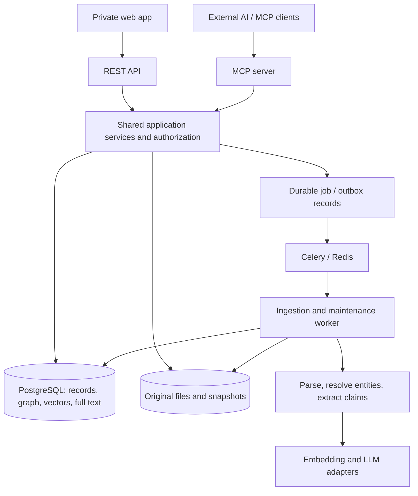
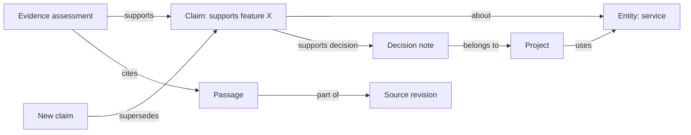

# Second brain: concept and technology stack

Status: proposal, 8 October 2026. Companion: [draft PRD](prd.md).

Implementation: the [working spike](spike.md) uses TypeScript and embedded PostgreSQL with pgvector to run in this workspace without Python or Docker. The proposal below preserves the original architecture discussion.

## 1. Product concept

A private, evolving knowledge system that helps you capture what you learn, connect it to existing knowledge, retrieve it in context, and understand how much to trust it.

The core unit is a **claim with provenance**, alongside personal notes, concepts, projects, and source documents. A claim might be “This service supports feature X,” “This experiment improved my print quality,” or “I prefer this workflow.” These statements need different kinds of evidence and different review schedules.

The system should answer five questions:

1. What do I know about this topic?
2. Where did that knowledge come from?
3. What supports or challenges it?
4. Is it still applicable, and when was it last checked?
5. How does it connect to my other knowledge and projects?

Example: import a vendor's documentation, extract a claim about a feature, connect it to the vendor and a project, retain the exact supporting passage, and schedule a review. A later document can supersede the claim or raise a conflict without erasing its history. An assistant accessing the system receives the claim, citation, validity dates, and any warnings together.

### Working assumptions

- One owner initially; a private web app and external MCP clients.
- Self-hostable, with persistent local storage; hosted model calls are explicitly configurable.
- English and German are initial evaluation languages.
- Start with notes, Markdown/text files, text PDFs, and public web pages.
- Initial benchmark envelope: 10,000 source revisions, 100,000 passages, and 100,000 claims. These are design targets to test, not demonstrated capacity.
- Preserve exportability and source material so indexes and AI outputs can be rebuilt.

## 2. Vectors and the knowledge graph

Use three complementary retrieval mechanisms:

| Mechanism         | Purpose                                       | Example                                                    |
| ----------------- | --------------------------------------------- | ---------------------------------------------------------- |
| Vector similarity | Find semantically related passages and claims | “How can I reduce stringing?” finds notes about retraction |
| Full-text search  | Find exact terms, names, IDs, and phrases     | A part number or an error code                             |
| Explicit graph    | Follow meaningful, explainable relationships  | Project → decision → claim → supporting source             |

A vector index does not supply the domain graph. Even an HNSW index's internal graph describes search structure, not relationships such as “supports” or “supersedes.” Store those relationships explicitly. pgvector supports vector similarity indexing; PostgreSQL supplies full-text search and recursive queries that can implement bounded graph traversal. [pgvector documentation](https://github.com/pgvector/pgvector), [PostgreSQL full-text search](https://www.postgresql.org/docs/current/textsearch.html), [recursive queries](https://www.postgresql.org/docs/current/queries-with.html).

### Recommended storage decision

**Start with PostgreSQL + pgvector, storing graph nodes and typed edges in relational tables.** This is an architectural recommendation for the assumed personal workload: one canonical database makes versioning, evidence, access controls, and transactional updates easier to keep consistent.

| Option                                     | Benefits                                                                                             | Costs                                                                                 | Decision                                                |
| ------------------------------------------ | ---------------------------------------------------------------------------------------------------- | ------------------------------------------------------------------------------------- | ------------------------------------------------------- |
| PostgreSQL + pgvector + graph tables       | One canonical store; SQL constraints; semantic and lexical search; practical for small neighborhoods | Traversal and graph analytics require more application work                           | Recommended MVP                                         |
| Neo4j with native vector/full-text indexes | Graph-native queries and traversal; direct property-graph modeling                                   | Different persistence tooling; application records and file storage still need design | Prefer if complex graph exploration is the main product |
| Separate vector and graph databases        | Independent search and graph scaling                                                                 | Multiple indexes, synchronization, deletion propagation, and recovery                 | Defer until a measured bottleneck justifies it          |

Neo4j offers vector indexes and supports combining vector and full-text results for hybrid retrieval. It is a credible graph-first alternative, rather than a requirement for drawing a graph. [Neo4j vector indexes](https://neo4j.com/docs/cypher-manual/current/indexes/semantic-indexes/vector-indexes/).

Reconsider storage when representative graph workloads cannot meet the latency target after indexing and query tuning, or the product needs extensive variable-length traversal/community analytics. If adding Neo4j later, keep PostgreSQL canonical and publish a rebuildable graph projection through an outbox; do not start with two canonical stores.

## 3. Recommended technology stack

| Layer                    | Proposed choice                                                   | Why                                                                                                                                                                                 |
| ------------------------ | ----------------------------------------------------------------- | ----------------------------------------------------------------------------------------------------------------------------------------------------------------------------------- |
| Web UI                   | React + TypeScript + Vite                                         | A straightforward app for capture, review, search, and graph exploration; [Vite documentation](https://vite.dev/guide/)                                                             |
| Graph visualization      | Three.js + OrbitControls                                          | Animated knowledge globe, curved connections, node selection, and camera flights; [official documentation](https://threejs.org/docs/)                                               |
| Backend                  | Python + FastAPI + Pydantic                                       | Typed request contracts and access to document/model tooling; [FastAPI documentation](https://fastapi.tiangolo.com/)                                                                |
| Persistence              | PostgreSQL + pgvector; GIN full-text indexes                      | Canonical records, vector search, and lexical retrieval in one database; sources above                                                                                              |
| Data access              | SQLAlchemy + Alembic                                              | Explicit models and versioned database migrations; [SQLAlchemy](https://docs.sqlalchemy.org/en/20/), [Alembic](https://alembic.sqlalchemy.org/en/latest/)                           |
| Background processing    | Celery + Redis broker                                             | Separate ingestion/review jobs from requests; PostgreSQL retains canonical job status; [Celery documentation](https://docs.celeryq.dev/en/stable/getting-started/introduction.html) |
| Document ingestion       | Docling for PDF; direct Markdown/text readers and an HTML adapter | Preserve document structure and citation locations; Docling supports PDF parsing and local execution; [Docling documentation](https://docling-project.github.io/docling/)           |
| Embeddings               | Local `intfloat/multilingual-e5-base` initial candidate           | Concrete multilingual baseline; 768 dimensions; evaluate on your corpus before committing; [publisher model card](https://huggingface.co/intfloat/multilingual-e5-base)             |
| Extraction and synthesis | One configurable LLM provider through a narrow adapter            | Schema-validated claim extraction and cited answers; select the exact model using the evaluation corpus and privacy constraints                                                     |
| MCP                      | Official Python MCP SDK                                           | Expose the same application services as typed tools; [official SDK](https://github.com/modelcontextprotocol/python-sdk)                                                             |
| Files                    | Content-addressed files on a persistent volume; storage adapter   | Simple local MVP; compatible object storage can replace the adapter later                                                                                                           |
| Deployment               | Docker Compose: web, API/MCP, worker, PostgreSQL, Redis           | Reproducible self-hosting and persistent volumes; add TLS and an authorization server for remote access                                                                             |

Pin supported versions and model revisions at implementation time. The exact LLM and remote authorization-server product remain implementation decisions; this proposal does not assume that any generic OIDC provider automatically satisfies MCP authorization.

For the E5 candidate, respect its tokenizer limit and the required `query:`/`passage:` prefixes, including for German text. Start with approximately 250–350 model tokens per passage, reserving room for title/context, and verify the final tokenized length against its 512-token limit. Store embedding model ID, revision, dimension, input hash, and chunker version. A new embedding model gets a separate index namespace until re-indexing completes. [E5 model card](https://huggingface.co/intfloat/multilingual-e5-base).

## 4. Architecture



The web app normally calls REST. MCP is an additional interface for assistants and other clients; the browser does not need to route ordinary UI operations through MCP. Both interfaces enforce the same validation, permissions, and knowledge rules.

Redis is a delivery mechanism, not the source of job truth. Create an import record and outbox event transactionally; dispatch pending events and make worker stages idempotent. Persist stage checkpoints, attempts, errors, and results in PostgreSQL so a failed broker or repeated task does not lose an import or duplicate knowledge.

## 5. Knowledge model

| Record          | Essential fields                                                                                         |
| --------------- | -------------------------------------------------------------------------------------------------------- |
| Source          | ID, origin type/URL, owner, author/publisher, lineage group, visibility, source status                   |
| Source revision | Source ID, content hash, immutable snapshot path, published/observed/imported dates, parser version      |
| Passage         | Revision ID, text, page/heading/character anchors, content hash, language                                |
| Entity          | ID, type, canonical name, aliases, resolution status                                                     |
| Note            | Owner-authored text, topic/project links, timestamps, revision history                                   |
| Claim           | Statement, knowledge kind, subject/predicate/object when available, context, lifecycle, version          |
| Evidence        | Claim ID, passage or personal-observation reference, support/challenge relation, assessment and assessor |
| Relation        | Typed endpoints, origin, status; asserted factual relations reference a backing claim                    |
| Review          | Target ID/version, actor, decision, rationale, evidence examined, review/verification dates              |
| Derivation      | Summary/inference ID, dependency IDs and versions, method/model, invalidation status                     |
| Import job      | Input ID, idempotency key, stage, checkpoints, attempt count, warnings/errors, costs                     |

Every record carries ownership/visibility where relevant. Foreign keys and transaction rules prevent dangling evidence. A source can support many claims; one claim can have many supporting and challenging observations.

Treat a claim as a graph node so evidence can attach to the assertion itself. A convenient `Entity → predicate → Entity` view may be generated from an accepted structured claim, but the underlying claim and its evidence remain inspectable.



AI-suggested factual relationships start as candidates with provenance. Curated organizational links such as a note belonging to a project can be accepted directly. A semantic “related to” suggestion is visibly different from an evidence-backed factual relationship.

## 6. Quality, evidence, and time

Quality is a set of dimensions, not an uncalibrated “92% true” badge.

| Dimension              | What to store/display                                                                  |
| ---------------------- | -------------------------------------------------------------------------------------- |
| Provenance             | Exact source revision, passage, author, capture date, and extraction method            |
| Evidence assessment    | Unsupported, self-reported, cited, corroborated, or challenged, with rationale         |
| Source suitability     | Primary/secondary/personal source; expertise, methodology, and relevance to this claim |
| Extraction reliability | Whether parsing and extraction faithfully represented the passage; separate from truth |
| Review status          | Candidate, accepted, rejected; who reviewed it and what they reviewed                  |
| Freshness              | Last substantive verification, review due date, and topic policy                       |
| Applicability          | Valid-from/valid-to dates, version, jurisdiction, project, and other contextual scope  |
| Disagreement           | Conflicting claims and unresolved challenges                                           |

Accepting a claim means choosing to keep it. It does not automatically establish that it is verified. A personal preference can be accepted and self-reported without external citations. A model's confidence cannot upgrade a claim to verified.

Store independent lifecycle and quality fields: lifecycle `candidate / active / superseded / rejected / archived`; freshness `unknown / current / review_due / stale / expired`; evidence assessment and conflict flags are separate. A claim can be active, corroborated, and stale at the same time.

Proposed freshness rules: a known end of applicability takes precedence as `expired`; otherwise unverified claims remain `unknown`. Verified claims are `current` until their review date, `review_due` during a configurable grace period (initially 30 days), then `stale`. A no-schedule policy stays current unless evidence or applicability changes. Historical retrieval assesses applicability at the requested date and still displays when verification actually occurred.

### Distinguish three time concepts

1. **Review interval:** when you should check again. Passing it creates a task, not a deletion.
2. **Valid interval:** when a statement applies in the real world. Expired/superseded statements remain available for historical questions.
3. **Retention period:** when data should be physically removed. This is a privacy/storage policy, independent of truth and freshness.

Record both valid time and recorded time, including versioned changes, so “What was true then?” and “What did I believe then?” can be distinguished.

Proposed configurable defaults, to tune through actual use:

| Knowledge category                           | Suggested review interval | Handling                                              |
| -------------------------------------------- | ------------------------- | ----------------------------------------------------- |
| Price, availability, rapidly changing status | 7–30 days                 | Review soon; avoid presenting as current when overdue |
| Software capability or procedure             | 90 days                   | Also scope by product/version                         |
| Personal workflow/preference                 | 180 days                  | Ask whether it still applies                          |
| Established concept                          | 365 days or manual        | Low review priority unless challenged                 |
| Historical event or completed observation    | No automatic expiry       | Preserve event date; review only if evidence changes  |

An optional ranking hint is `freshness = 2^(-age_days / half_life_days)`. It estimates review priority, not truth probability. If there has been no verification, show “unknown,” rather than treating import time as verification. Reading a claim or fetching an unchanged page does not reset verification.

Count independent evidence lineages, not URLs: five websites copying one paper do not establish five independent confirmations. Contradiction detection considers subject, predicate, object, time, and scope, and proposes conflicts for review. Different product versions can explain a difference without a contradiction.

Changed, retracted, or removed evidence invalidates dependent verification/summaries and schedules reassessment. Missing network access is “could not check,” not “false.”

## 7. Building and importing knowledge

1. **Capture:** note, file, or public URL, with owner, topic/project, and visibility.
2. **Preserve:** immutable original/snapshot and hash; same bytes do not create duplicate revisions within the same authorized collection.
3. **Parse:** normalize text, retain anchors, detect language and extraction failures.
4. **Index passages:** make source material searchable before claim review, clearly labeled as source text.
5. **Extract candidates:** bounded, schema-validated claims/entities/evidence references. A passage establishes what the source says, not necessarily what is true.
6. **Resolve and connect:** suggest aliases, merges, contextual links, and overlapping/conflicting claims. Avoid automatic merging based only on embedding similarity.
7. **Review:** batch accept, edit, reject, or request better evidence; distinguish acceptance from verification.
8. **Maintain:** schedule verification, fetch new snapshots, invalidate dependent outputs, and keep historical revisions.

Validate that cited spans exist in the parsed revision. Record model, prompt, parser, and schema versions. Enforce document/claim/token budgets; save partial results and explain truncation instead of silently losing material.

Knowledge growth should also include attaching new evidence, recording experiment outcomes, writing decision rationale, and creating topic summaries with dependency links. Generated summaries do not become new independent evidence for their own source claims.

## 8. Retrieval and answers

1. Apply owner/collection permissions and requested topic/time filters to every retrieval path.
2. Retrieve lexical and semantic candidates separately; fuse ranks using reciprocal rank fusion.
3. Expand promising entities/claims through approved typed edges, initially at most two hops, with node/edge budgets.
4. Deduplicate revisions/lineages; rank by relevance, evidence, and query-appropriate temporal applicability. Apply quality as a secondary signal so broadly trusted material cannot swamp a relevant result.
5. Return a structured evidence bundle: claim/passage IDs, citations, quality dimensions, conflicts, and `as_of` time.
6. Optionally generate an answer supported by that bundle, distinguishing supported assertions, personal views, inferences, and unanswered questions.

Current queries exclude expired/superseded claims by default; stale knowledge can appear with a warning, while users can request strict current-only results. A historical query uses the valid interval and can opt into recorded-time history. Unsupported and unresolved material remains discoverable in a visibly separate section.

Benchmark hybrid retrieval against hybrid retrieval plus graph expansion. Graph expansion is useful when it improves contextual or multi-hop questions; it should not be mandatory for every lookup. Start without an extra reranker service, then add one if relevance evaluation justifies it.

Approximate vector search can lose candidates when combined with restrictive filters. Verify filtered recall and use iterative scans, increased search budgets, or exact search on small subsets as needed. Authorization filtering must never depend on recovering enough approximate matches. [pgvector filtering documentation](https://github.com/pgvector/pgvector#filtering).

## 9. MCP interface

Use Streamable HTTP for remote clients and an optional stdio adapter for local integrations. Verify interoperability against the chosen clients and supported protocol revisions. These are standard MCP transport bindings; HTTP authorization has a separate OAuth-based specification. [MCP transports](https://modelcontextprotocol.io/specification/latest/basic/transports), [MCP authorization](https://modelcontextprotocol.io/specification/latest/basic/authorization).

| Tool                | Purpose                                                          | Required scope |
| ------------------- | ---------------------------------------------------------------- | -------------- |
| `search_knowledge`  | Hybrid results/evidence bundle with filters and warnings         | `brain:read`   |
| `get_knowledge`     | Note/claim details, citations, versions, and quality             | `brain:read`   |
| `query_graph`       | Bounded neighborhood by IDs, edge types, and time                | `brain:read`   |
| `add_knowledge`     | Capture a note or propose claims with context                    | `brain:write`  |
| `import_source`     | Import an approved public URL or an existing uploaded-file ID    | `brain:write`  |
| `get_import_job`    | Poll progress, warnings, and candidate counts                    | `brain:read`   |
| `attach_evidence`   | Add a cited support/challenge assessment for review              | `brain:write`  |
| `review_knowledge`  | Accept/reject, or record substantive verification with rationale | `brain:review` |
| `update_knowledge`  | Versioned edits, context, or review policy changes               | `brain:write`  |
| `archive_knowledge` | Reversible archive; separate from physical deletion              | `brain:write`  |

Default assistant credentials have read/write access and create candidates; review scope is reserved for the owner's trusted review interface or an explicitly authorized reviewer. Clients cannot assign themselves verification or change source quality through arbitrary metadata. Physical purge stays in the owner UI for the MVP.

Tool inputs/outputs have explicit schemas; results include IDs, timestamps, provenance, warnings, and pagination. Writes require idempotency keys; edits/reviews use expected versions and return a conflict on concurrent change. Imports return a job ID quickly. Graph requests accept constrained filters rather than raw SQL/Cypher. [MCP tools specification](https://modelcontextprotocol.io/specification/latest/server/tools).

Example application payload for `search_knowledge`, not a full MCP protocol message:

```json
{
  "query": "What do I know about service X for project Y?",
  "project_id": "project_y",
  "temporal_mode": "current",
  "include_stale": true,
  "limit": 10
}
```

MCP HTTP exposure requires TLS and specification-compatible authorization discovery/token validation. Independently enforce tool scopes and collection visibility in application services. Tool descriptions/annotations aid client behavior but do not replace server authorization. Local development binds to loopback; remote publication is a later deployment decision, gated by these requirements.

## 10. Web app and graph experience

Five main views:

- **Capture/inbox:** quick note, upload, URL import, and progress.
- **Search/ask:** searchable sources, accepted claims, cited answers, and contextual filters.
- **Knowledge detail:** evidence drawer, source excerpt, versions, conflicts, and review actions.
- **Graph explorer:** focus on a project/topic/entity, then expand deliberately.
- **Review queue:** pending extractions, suspected duplicates/conflicts, and overdue verification.

Show a small useful graph initially, not every passage. Node shape distinguishes entity, claim, note, and source; color represents type; badges/dashed outlines express freshness and review state. Edge labels explain relationships. Provide a legend and an accessible list/table alternative, avoiding reliance on color alone.

Clicking a claim reveals supporting and challenging evidence. Graph filters include topic, project, source, lifecycle, evidence status, and time. Start with one-hop views, initially up to 100 nodes, with an explicit server cap of 250 nodes/500 edges and a truncation indicator. Passage/evidence nodes appear on demand to keep overview graphs readable.

## 11. Delivery strategy and risks

Build a complete small path first: import one text document → inspect extracted claims → accept one → retrieve it with evidence → explore its neighborhood → perform the same read/write flow through MCP.

Then expand input formats and lifecycle handling. Test representative data before adding databases or agent frameworks. The draft PRD defines milestones and measurable release gates.

Main risks are inaccurate extraction, incorrect entity merges, false corroboration from copied sources, graph clutter, review fatigue, ingestion cost, and data exposure. Mitigations are provenance anchors, candidate review, lineage groups, bounded views, prioritized review queues, explicit budgets, and shared authorization.

Keep imported content untrusted: it must not become instructions for the application or gain tool permissions. URL ingestion must reject private/network metadata targets, recheck redirects and resolved addresses, and apply size/time limits. Keep uploaded files within managed storage; MCP tools never accept arbitrary server file paths.

Use an owner-configured policy before sending source text to a hosted model. Preserve an operation log and backups, but exclude secrets and full private source content from routine logs. Export notes, claims, relations, evidence, source snapshots, and versions in documented formats so the second brain remains portable.
