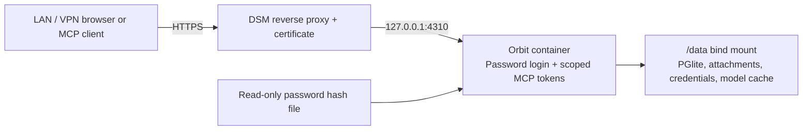

# Synology DS423+ deployment

Target: DS423+, DSM 7.2.2-72806 Update 9, 6 GB installed RAM, LAN/VPN access. The image targets `linux/amd64`. One container serves the built web app, REST/MCP endpoints, PGlite, and background workers. The globe renders on the client. Start with the Compose limits of two CPU cores, two inference threads, and 2 GB container memory; these are initial budgets, not measured NAS requirements.

## Access and persistence



The container listens on `0.0.0.0` internally; its published host port is bound to `127.0.0.1`, so browsers use the DSM reverse proxy. Password mode replaces the desktop's automatic owner login. Sessions are random, stored as hashes in process memory, expire after eight hours, and are revoked on logout. Restarting the container signs browsers out; persistent MCP credentials survive. Login attempts are limited. The owner password never becomes an MCP token.

`APP_ORIGIN` must be the exact HTTPS origin used by browsers, without an application path. Host and Origin checks remain enabled. HTTPS is also required by the UI's UUID and clipboard APIs. Use a certificate trusted by the devices accessing the app. A DSM reverse-proxy rule does not itself authenticate users; Orbit supplies the password login.

## 1. Prepare the image and owner password on your computer

From this checkout, using Docker Desktop in Linux-container mode:

```powershell
npm.cmd run auth:password
docker build --platform linux/amd64 -t orbit:nas-spike .
docker save -o orbit-nas-spike.tar orbit:nas-spike
```

The password command asks for a password and confirmation without echoing either, then creates `.secrets/owner-password.json`. Use at least 12 characters. It stores a salted scrypt hash, not the password. An existing output file is never overwritten; for a password change, generate a new file using `npm.cmd run auth:password -- .secrets/owner-password-new.json`.

Transfer the image TAR, `compose.synology.yml`, `deploy/synology.env.example`, and the hash file to the NAS. No source checkout or Node installation is needed on the NAS. TAR image bundles contain application code and dependencies; Docker's build context excludes `.data`, `.env*`, `.secrets`, and NSX exports. Do not put your backup into the image. A registry can replace the TAR workflow later by changing the Compose `image` value to a published, versioned image.

## 2. Prepare NAS folders and permissions

Create a project folder, for example:

```text
/volume1/docker/orbit/
  compose.synology.yml
  .env
  data/
  secrets/
    owner-password.json
```

Copy `deploy/synology.env.example` to `.env` beside the Compose file and customize the URL, paths, and IDs. `APP_UID` and `APP_GID` must identify a non-root account with write permission on `data/` and read permission on the hash file. Use `id your-nas-user` over SSH to discover its numeric IDs, or have the NAS administrator supply them. UID/GID 1000 are examples, not Synology's guaranteed user IDs. Restrict the secret folder to the intended account/administrators; do not grant broad write permissions.

All persistent state lives under the `/data` mount. Use NAS-local storage rather than SMB/NFS for the live database. Do not run two instances against the same directory, share that directory with a desktop instance, or use the project removal option to delete retained data. The container filesystem is read-only apart from `/data` and temporary `/tmp`.

## 3. Configure the HTTPS hostname

Choose a hostname that resolves to the NAS from your LAN and VPN clients, such as a subdomain you own. `https://brain.example.com` in the template is a placeholder, not a working DNS record.

In DSM:

1. Import/create a certificate under **Control Panel → Security → Certificate** and arrange trust/renewal appropriate to your hostname.
2. Open **Control Panel → Login Portal → Advanced → Reverse Proxy** and create a rule:
   - Source: **HTTPS**, your app hostname, port **443**.
   - Destination: **HTTP**, hostname **127.0.0.1**, port **4310** (or your chosen `APP_PORT`).
3. Assign the app's certificate to that reverse-proxy service.
4. Permit HTTPS access from your LAN/VPN as needed. Router port forwarding is not needed for this deployment.

The proxy must preserve the app hostname in `Host`, `Origin`, and bearer `Authorization` headers. It must forward `/api/*` and `/mcp` as well as `/`. Adjust request-body limits for NSX archives up to 512 MB and backups, and timeouts for larger imports/exports. Keep the app on its own hostname, not a rewritten URL subpath.

Leave `TRUST_PROXY` empty initially. This ignores forwarded client IP headers; login throttling may therefore apply to clients collectively behind the proxy. If individual client-IP throttling is needed, configure only the actual proxy peer IP/CIDR and ensure DSM replaces untrusted forwarded headers. Do not use an unrestricted `trust proxy=true` setting. Host validation always checks the actual Host header rather than trusting forwarded hostnames.

## 4. Start the Container Manager project

1. In **Container Manager → Image**, import `orbit-nas-spike.tar` from the NAS.
2. In **Project**, create a project using the prepared folder and `compose.synology.yml`.
3. Start the project and check logs and container health.
4. Open the configured HTTPS URL and sign in with the owner password.

Compose requires an `APP_ORIGIN` value. The server also refuses network mode without a valid password hash and HTTPS origin. Do not switch `ACCESS_MODE` to `local` in the container. The default desktop `npm run dev` continues to use loopback-only local mode.

An initial model download needs outbound internet access. Cached weights remain under `data/models/`. If inference cannot load on the NAS or resource use is excessive, set `EMBEDDINGS=lexical` in `.env` and recreate the container. This preserves data and keyword search but disables semantic search and categorization. `EXTRACTION=extractive` avoids running a generative LLM on the NAS. The optional Ollama integration still requires a loopback endpoint and is not part of this deployment.

## 5. Move the current knowledge collection

1. In the desktop app, use **Settings → Export backup** to download the portable ZIP.
2. Start the NAS with an empty `data/` folder and `SEED_DEMO=false` (already set in Compose).
3. Sign in and use **Settings → Restore backup** to upload the ZIP.
4. Compare knowledge/source counts and check representative notes, original dates, attachments, evidence, and owner category corrections.
5. Wait for search indexing and semantic categorization to settle. Test a meaningful English/German search and graph branch.

Use the portable application backup to move between Windows and Linux instead of copying a running physical database. The password hash and MCP credentials are deployment secrets, not part of the portable knowledge backup. New NAS storage generates new MCP tokens; configure clients using the NAS Settings endpoint and tokens. Existing clients may continue to use the desktop instance until you intentionally switch them, but changes made in both instances will not synchronize.

## Maintenance and validation

Before transferring a newly built image, `npm.cmd run test:container` checks its non-root, read-only Linux runtime with an isolated synthetic data volume: password login/logout, MCP scopes, background imports, backup export, SQL inspection, clean shutdown, and persistent data/tokens after restart. It removes its own container and volume afterward. `npm.cmd run test:container -- --with-model` additionally checks offline CPU inference against the public model cache in `.data/models/` (prepare it with `npm.cmd run models:download`). The desktop knowledge database is never mounted by this check. Browser checks use `npm.cmd run test:e2e`; the HTTPS fixture needs OpenSSL on PATH, or the copy bundled with Git for Windows.

- Check that incorrect passwords are rejected, logout invalidates the session, and a browser restart/login works through HTTPS.
- Capture a note, import a small document, open an attachment, confirm a category, and query MCP with reader/contributor tokens.
- Stop/start the project and confirm data persistence and job recovery. A restart invalidates browser sessions by design.
- Inspect Resource Monitor during initial indexing. Reduce inference load or use lexical mode if the initial budget is too tight.
- Export application backups regularly. For filesystem snapshots, stop the container and wait for shutdown first; taking an arbitrary live folder copy is not a backup procedure.
- Before an image update, retain a backup and the previous image. Recreate the container using the same data mount. The server drains HTTP requests and active background tasks before closing PGlite, with a 120-second deadline; Compose allows 150 seconds before forcing termination.
- A health check confirms that HTTP is serving; it does not certify model readiness or retrieval quality. Check model/job status in Settings/Sources too.
- Change the password by generating a replacement hash, replacing the mounted file while stopped, and restarting the container. Old browser sessions are then invalid. MCP credentials are independent.

## Database inspection

While running, **Export backup** gives you `brain.json` and retained attachments without opening another database process. Do not publish these files: they contain your private collection.

For SQL, stop the API first and use the read-only inspection command from the checkout:

```powershell
npm.cmd run db:inspect -- --stopped
```

It verifies that an existing database is present, copies it into a separate `postgres-inspect-*` folder, and queries only that copy without applying application schema migrations. The copy is retained for inspection and contains private data. With a different `DATA_DIR`, supply the physical database directory explicitly. For a custom query, put one SELECT/WITH/EXPLAIN/SHOW statement in a SQL file and pass `--sql-file=queries.sql`; PostgreSQL read-only mode blocks database writes.

To inspect on the NAS, stop the main container, then run a temporary container over the same NAS data folder. Substitute your numeric user/group IDs and data path:

```sh
docker run --rm --user 1026:100 \
  -v /volume1/docker/orbit/data:/data \
  --entrypoint node orbit:nas-spike \
  build/scripts/inspect-db.js /data/postgres --stopped
```

Do not run this while the application container owns the database. The CLI cannot determine whether another process is using the files; `--stopped` is your explicit acknowledgement. Restart the project afterward. PGlite has no PostgreSQL TCP port in this application. A socket adapter for DBeaver/pgAdmin would be a separate feature and must share the application's database instance; do not launch another server over the live directory.

## References

- [Synology DS423+ CPU and memory specifications](https://kb.synology.com/en-global/DSM/tutorial/What_kind_of_CPU_does_my_NAS_have)
- [Synology Container Manager projects](https://kb.synology.com/en-global/DSM/help/ContainerManager/docker_project?version=7)
- [PGlite API and persistence](https://pglite.dev/docs/api)
- [PGlite socket adapter](https://pglite.dev/docs/pglite-socket)
